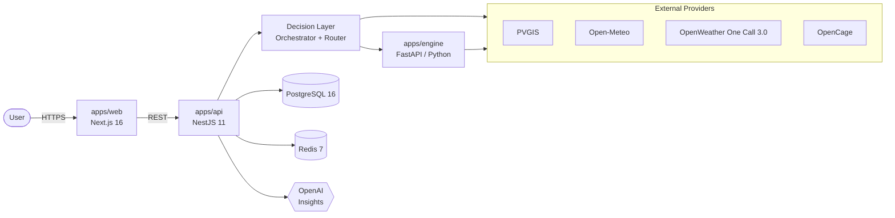

<div align="center">

# Solar Intelligence Platform

**Deterministic solar production intelligence — forecast, score, and act on every watt.**

[](https://github.com/stato10/Solar-Intelligence-Platform/actions/workflows/ci.yml)
[](./LICENSE)
[](https://www.conventionalcommits.org)
[](./CONTRIBUTING.md)

</div>

---

## Overview

The **Solar Intelligence Platform** is a web-first, service-oriented system that turns
raw solar, weather, and tariff data into actionable production intelligence. It ingests
data from external providers (PVGIS, Open-Meteo, OpenWeather One Call 3.0, OpenCage),
runs a **deterministic Python calculation engine** for forecasts, soiling/heat/risk
scoring, and financial estimation, then layers an AI insight service on top of the
deterministic outputs for human-readable explanations.

> **Status:** active development — scaffold, domain CRUD, providers, engine, dashboard,
> PostgreSQL/Prisma persistence, JWT auth with ownership enforcement, and the
> marketplace/leads flow are implemented. See [`TODO.md`](./TODO.md) for the live phase tracker.

## Features

- **Deterministic forecasting** — Python FastAPI engine produces reproducible
  production, soiling, heat, risk, opportunity, and financial outputs from a single
  versioned input payload.
- **Multi-provider orchestration** — pluggable solar/weather/geolocation adapters
  with explicit fallback chains (PVGIS → engine fallback, Open-Meteo ↔ OpenWeather,
  OpenCage geocoding).
- **Recommendation router** — converts deterministic engine output into prioritized
  user actions (alerts, opportunities, maintenance, finance).
- **AI insight layer** — OpenAI structured outputs for natural-language explanations
  on top of deterministic results only (never as a source of truth).
- **Production-grade web app** — Next.js 16 + React 19 + Tailwind 4 + Radix UI +
  Framer Motion, with a design-token system and reusable shell.
- **Type-safe contracts** — shared `@sip/types` package between web and api;
  `class-validator` DTOs on the API; Zod on the web.
- **First-class local dev** — Docker Compose for Postgres + Redis, one-command
  monorepo dev (`npm run dev`), seeded demo data via Prisma.

## Tech Stack

| Layer        | Technology                                                                          |
| ------------ | ----------------------------------------------------------------------------------- |
| Web          | Next.js 16 (App Router), React 19, TypeScript 5, Tailwind CSS 4, Radix UI, Framer Motion |
| API          | NestJS 11, TypeScript 5, Prisma 7, class-validator, JWT (`jsonwebtoken`), bcryptjs  |
| Engine       | Python 3.12, FastAPI, Uvicorn, Pydantic                                             |
| Data         | PostgreSQL 16, Redis 7 (optional cache)                                             |
| AI           | OpenAI structured outputs (explanations only)                                       |
| Tooling      | npm workspaces, ESLint 9, Prettier, Conventional Commits, Husky, lint-staged        |
| Infra        | Docker Compose (local), container-ready images for `web` / `api` / `engine`        |

## Architecture



Full diagram and component responsibilities: [`ARCHITECTURE.md`](./ARCHITECTURE.md).

## Monorepo Layout

```text
solar-intelligence-platform/
├── apps/
│   ├── web/        # Next.js 16 (App Router) + React 19 + Tailwind 4
│   ├── api/        # NestJS 11 + Prisma 7 + PostgreSQL
│   └── engine/     # FastAPI deterministic calculation engine (Python 3.12)
├── packages/
│   ├── types/      # Shared TypeScript types (@sip/types)
│   └── config/     # Shared configuration (@sip/config)
├── docs/           # Product map + redesign specs (core docs live at repo root)
├── .github/        # CI workflows
└── docker-compose.yml
```

## Getting Started

### Prerequisites

| Tool       | Version                | Notes                                                  |
| ---------- | ---------------------- | ------------------------------------------------------ |
| Node.js    | `22.x` (LTS)           | Pinned via [`.nvmrc`](./.nvmrc) — run `nvm use`        |
| npm        | `>= 10`                | Ships with Node 22                                     |
| Python     | `3.12+`                | Required for the FastAPI engine                        |
| Docker     | `>= 24`                | Postgres + Redis via the bundled `docker-compose.yml`  |

### Install

```bash
git clone https://github.com/stato10/Solar-Intelligence-Platform.git
cd Solar-Intelligence-Platform
nvm use
cp .env.example .env
npm install
npm run engine:setup
```

### Configure environment

Copy `.env.example` to `.env` at the repo root and fill in the secrets you need
(OpenAI, OpenCage, OpenWeather). All variables are documented inline in
[`.env.example`](./.env.example); provider-specific details live in
[`EXTERNAL_APIS.md`](./EXTERNAL_APIS.md).

### Run the platform

```bash
docker compose up -d postgres redis   # data services
npm run dev                            # web + api + engine concurrently
```

Or run services individually:

```bash
npm run dev:web      # Next.js on http://localhost:3001
npm run dev:api      # NestJS  on http://localhost:${API_PORT} (3002 in .env.example)
npm run dev:engine   # FastAPI on http://localhost:8000
```

### Build & lint

```bash
npm run build       # build web + api
npm run lint        # eslint (web) + tsc --noEmit (api)
```

### Database (Prisma)

```bash
npm --workspace @sip/api run prisma:generate
npm --workspace @sip/api run prisma:migrate:dev
npm --workspace @sip/api run db:seed
```

The Prisma schema lives at [`apps/api/prisma/schema.prisma`](./apps/api/prisma/schema.prisma);
the persistence model is documented in [`DB_SCHEMA.md`](./DB_SCHEMA.md).

## Scripts

Root-level scripts (defined in [`package.json`](./package.json)):

| Script                  | What it does                                                            |
| ----------------------- | ----------------------------------------------------------------------- |
| `npm run dev`           | Run `web`, `api`, and `engine` concurrently                             |
| `npm run dev:web`       | Next.js dev server on port `3001`                                       |
| `npm run dev:api`       | NestJS dev server (watch mode)                                          |
| `npm run dev:engine`    | FastAPI engine via Uvicorn on port `8000`                               |
| `npm run build`         | Build the web and api workspaces                                        |
| `npm run lint`          | ESLint (web) + `tsc --noEmit` (api)                                     |
| `npm run engine:setup`  | `pip install -r apps/engine/requirements.txt`                           |

Engine and integration smoke tests:

```bash
python -m py_compile apps/engine/src/main.py
python apps/engine/tests/run_golden.py
python apps/api/tests/run_engine_contract_smoke.py
python apps/api/tests/run_dashboard_contract_smoke.py
python apps/api/tests/run_dashboard_snapshot.py
```

## Deployment

- **Web** — Vercel-friendly (Next.js 16 App Router). Set `NEXT_PUBLIC_API_BASE_URL`.
- **API** — Container image; deploy to any container runtime (ECS, Fly.io, Render,
  Kubernetes). Requires `DATABASE_URL`, `JWT_SECRET`, and provider keys.
- **Engine** — Container image; stateless FastAPI service. Expose port `8000`.
- **Database** — Managed PostgreSQL recommended (RDS, Neon, Supabase, Cloud SQL).

All services ship with Dockerfiles and are wired together in
[`docker-compose.yml`](./docker-compose.yml); the env reference is
[`.env.example`](./.env.example).

## Roadmap

- [x] Phase 0 — Documentation freeze
- [x] Phase 1 — Monorepo scaffold
- [x] Phase 2 — Domain CRUD scaffolding
- [x] Phase 3 — Provider adapters & orchestration
- [x] Phase 4 — Deterministic calculation engine
- [x] Phase 5 — Dashboard integration
- [x] Phase 6 — Persistence hardening (Postgres/Prisma-backed domain stores)
- [x] Phase 7 — Marketplace conversion flow (providers, products, lead intents)
- [x] Phase 8 — Authentication & ownership enforcement (JWT, per-user resource scoping)
- [ ] Phase 9 — Observability (OpenTelemetry, Sentry, structured logs)
- [ ] Phase 10 — Automated test suites & CI hardening

Live tracker: [`TODO.md`](./TODO.md).

## Contributing

We welcome issues and pull requests. Please read
[`CONTRIBUTING.md`](./CONTRIBUTING.md) for setup, branching, Conventional Commits,
and the PR process.

## License

Released under the [MIT License](./LICENSE) — Copyright © 2026 Solar Intelligence
Platform contributors.
