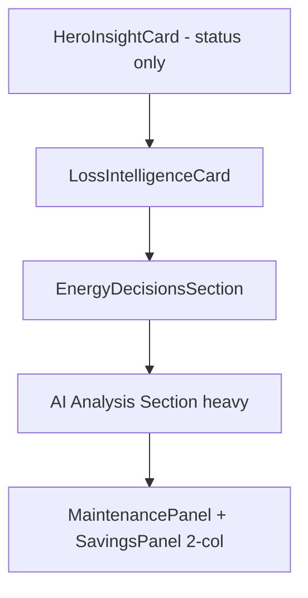
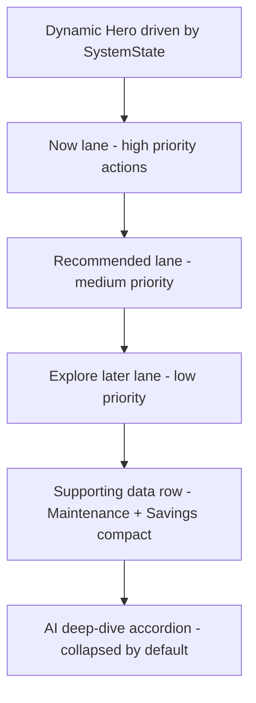

# 02 — Dashboard

The dashboard is the **command center**. When the user lands here, they must know within 2 seconds:

1. Is anything wrong right now.
2. How much money is involved.
3. What the single best next action is.

Score baseline: **8/10**. Gap: hierarchy is too flat, AI section is too heavy, hero is too generic.

References: [00-design-tokens.md](./00-design-tokens.md), [01-state-contracts.md](./01-state-contracts.md), [11-ai-insight-card.md](./11-ai-insight-card.md), [12-empty-states.md](./12-empty-states.md), [13-voice-and-copy.md](./13-voice-and-copy.md), [17-monetization.md](./17-monetization.md).

---

## 1. Current state

Source files:

- Page entry: [apps/web/src/app/dashboard/page.tsx](../../apps/web/src/app/dashboard/page.tsx)
- Dashboard state helpers: [apps/web/src/app/dashboard/_components/dashboard-state.tsx](../../apps/web/src/app/dashboard/_components/dashboard-state.tsx)
- Main cards: [HeroInsightCard.tsx](../../apps/web/src/components/dashboard/HeroInsightCard.tsx), [LossIntelligenceCard.tsx](../../apps/web/src/components/dashboard/LossIntelligenceCard.tsx), [EnergyDecisionsSection.tsx](../../apps/web/src/components/dashboard/EnergyDecisionsSection.tsx), [MaintenancePanel.tsx](../../apps/web/src/components/dashboard/MaintenancePanel.tsx), [SavingsPanel.tsx](../../apps/web/src/components/dashboard/SavingsPanel.tsx)
- Right panel: [PerformanceStatsGrid.tsx](../../apps/web/src/components/dashboard/PerformanceStatsGrid.tsx), [WhatIfSimulator.tsx](../../apps/web/src/components/dashboard/WhatIfSimulator.tsx), [UsageWindowCard.tsx](../../apps/web/src/components/dashboard/UsageWindowCard.tsx), [AiInsightsPanel.tsx](../../apps/web/src/components/dashboard/AiInsightsPanel.tsx)
- Hardware CTA: [HardwareConnectCta.tsx](../../apps/web/src/components/dashboard/HardwareConnectCta.tsx)
- Onboarding: [OnboardingDialog.tsx](../../apps/web/src/components/dashboard/OnboardingDialog.tsx)

Layout today: `xl:grid-cols-[1fr_360px]`. The right panel already exists — good. The primary column is where hierarchy breaks down.

---

## 2. Problems

- **Hero is status-only.** "Your system is performing well" does not drive any action.
- **Equal-weight clutter.** Loss card, decisions section, maintenance panel, savings panel, AI section all compete.
- **AI section is too heavy.** Reads like engine output. Should be a compact Insight Card row with an accordion for deep-dive.
- **No action-priority grouping.** Everything is one flat stream.
- **No `SystemState` routing.** The hero does not change shape when state changes.

---

## 3. Redesign intent

Turn the primary column into a top-to-bottom priority stream: **dynamic hero → three grouped action lanes (Now / Recommended / Explore later) → AI deep-dive in an accordion**. Keep the right panel as the numeric + simulator support column.

---

## 4. Layout — before vs after

### Before



### After



Right panel remains: Performance snapshot → What-if simulator → Usage window → Connect system CTA.

---

## 5. ASCII pixel wireframe — desktop (xl ≥ 1280)

Tokens applied: container `max-w-[1280px]`, sidebar `240px`, right panel `320–360px`, outer gutter `24px`, inter-card gap `16–24px`, card padding `p-5` standard / `p-6` hero.

```
<-------------------------- 1280px container --------------------------->
+---------+-------------------------------+---------------------+
|         |  Dashboard                    |                     |
| SIDEBAR |  last updated 2 min ago       |                     |
|  240    |                               |                     |
|         |  +-------------------------+  |  +---------------+  |
|         |  |  HERO (p-6, r-2xl)      |  |  | Performance   |  |
|         |  |  state=SystemState      |  |  |   snapshot    |  |
|         |  |  H: text-3xl            |  |  |  4 stat tiles |  |
|         |  |  Sub: text-sm muted     |  |  +---------------+  |
|         |  |  [Primary CTA]          |  |                     |
|         |  |  confidence chip        |  |  +---------------+  |
|         |  +-------------------------+  |  | What-if       |  |
|         |                               |  | Simulator     |  |
|         |  Section: NOW (high)          |  |  toggles +    |  |
|         |  +-----------+ +-----------+  |  |  live delta   |  |
|         |  | Action A  | | Action B  |  |  +---------------+  |
|         |  | p-5       | | p-5       |  |                     |
|         |  | N.IS/mo   | | N.IS/mo   |  |  +---------------+  |
|         |  | [Solid]   | | [Solid]   |  |  | Usage window  |  |
|         |  +-----------+ +-----------+  |  |  day strip    |  |
|         |                               |  +---------------+  |
|         |  Section: RECOMMENDED (med)   |                     |
|         |  +-----------+ +-----------+  |  +---------------+  |
|         |  | Action C  | | Action D  |  |  | Connect       |  |
|         |  | [Outline] | | [Outline] |  |  | System CTA    |  |
|         |  +-----------+ +-----------+  |  +---------------+  |
|         |                               |                     |
|         |  Section: EXPLORE LATER       |                     |
|         |  + row of muted suggestions + |                     |
|         |  (text links, no CTAs)        |                     |
|         |                               |                     |
|         |  +-------------------------+  |                     |
|         |  | SUPPORTING DATA         |  |                     |
|         |  | Maintenance | Savings   |  |                     |
|         |  |  compact    |  compact  |  |                     |
|         |  +-------------------------+  |                     |
|         |                               |                     |
|         |  +-------------------------+  |                     |
|         |  | AI deep-dive accordion  |  |                     |
|         |  | (collapsed by default)  |  |                     |
|         |  +-------------------------+  |                     |
|         |                               |                     |
+---------+-------------------------------+---------------------+
          ^       primary column          ^  right panel 320-360
          24px                         24px
```

Vertical rhythm (top to bottom in primary column):

- Hero `p-6`.
- `mt-6` to Section: NOW.
- `mt-8` between sections (NOW → RECOMMENDED → EXPLORE).
- `mt-8` to Supporting Data row.
- `mt-6` to AI deep-dive accordion.

Right panel rhythm:

- Card stack gap `gap-4` (16px).
- Connect System card pinned to bottom at desktop via `sticky bottom-6` behavior.

---

## 6. Component changes

### Add

- **Action Lane wrapper** — a small presentational component that renders a section title (`Now` / `Recommended` / `Explore later`), an optional total N.IS/month chip, and a grid of action cards. Does not exist today. Suggested location: `apps/web/src/components/dashboard/ActionLane.tsx` (do not create in this phase; documented for Sprint 1).
- **Dynamic hero variant logic inside** [HeroInsightCard.tsx](../../apps/web/src/components/dashboard/HeroInsightCard.tsx) — accept `systemState: SystemState` and render five content modes (see [01-state-contracts.md](./01-state-contracts.md)).

### Modify

- [apps/web/src/app/dashboard/page.tsx](../../apps/web/src/app/dashboard/page.tsx) — replace the current flat stack of primary-column sections with three Action Lanes plus a Supporting Data row plus the AI accordion. Derive `systemState` via the view-model layer (see contract 1) and pass it to the hero.
- [HeroInsightCard.tsx](../../apps/web/src/components/dashboard/HeroInsightCard.tsx) — accept `systemState`, change headline/subheadline/CTA per state, never display "Your system is performing well" as the only message when optimization delta is non-trivial.
- [LossIntelligenceCard.tsx](../../apps/web/src/components/dashboard/LossIntelligenceCard.tsx) — collapse into the NOW lane as an Action Card sibling when `SystemState ∈ {critical, warning}`; hide entirely when `healthy`.
- [EnergyDecisionsSection.tsx](../../apps/web/src/components/dashboard/EnergyDecisionsSection.tsx) — split its children by `ActionPriority` into the three lanes; it becomes a router, not a visible section.
- [MaintenancePanel.tsx](../../apps/web/src/components/dashboard/MaintenancePanel.tsx) and [SavingsPanel.tsx](../../apps/web/src/components/dashboard/SavingsPanel.tsx) — render in a Supporting Data row near the bottom, reduced visual weight (smaller title, no own hero headline).
- [AiInsightsPanel.tsx](../../apps/web/src/components/dashboard/AiInsightsPanel.tsx) — wrap in an accordion that is collapsed by default. Individual items inside follow [11-ai-insight-card.md](./11-ai-insight-card.md).
- [HardwareConnectCta.tsx](../../apps/web/src/components/dashboard/HardwareConnectCta.tsx) — move into the right panel bottom slot; no longer lives between the hero and the action lanes.

### Remove / Replace

- Any "AI Analysis & Decisions" section header in the primary column. Replaced by the accordion.

---

## 7. State copy

Hero copy per `SystemState` (voice rules in [13-voice-and-copy.md](./13-voice-and-copy.md)):

- `critical`:
  - Headline: "Active loss detected: {metric}"
  - Sub: "Estimated impact: N.IS {X}/month. Recommended action: {action} within 48h."
  - CTA: "Resolve now"
- `warning`:
  - Headline: "{Metric} is drifting"
  - Sub: "If unattended, estimated loss is N.IS {X}/month."
  - CTA: "Inspect"
- `optimization`:
  - Headline: "Your system is stable today"
  - Sub: "You still have N.IS {X}/month optimization potential."
  - CTA: "Show opportunities"
- `healthy`:
  - Headline: "Your system is running well"
  - Sub: "Last 7 days: N.IS {X} saved, {Y} kWh produced."
  - CTA (demoted, text link): "See details"
- `no-data`: render the zero-data experience from [12-empty-states.md](./12-empty-states.md).

Empty / loading / error for the dashboard as a whole: see [12-empty-states.md](./12-empty-states.md) section 3.

---

## 8. Action priority mapping

Rules per [01-state-contracts.md](./01-state-contracts.md) applied here:

- **Now** — show only `high` priority actions. Examples: soiling cleaning when active loss > N.IS 50/mo, critical fault remediation, resolve a missing site configuration.
- **Recommended** — show only `medium`. Examples: automation scheduling, battery ROI, EV charger ROI.
- **Explore later** — show only `low`. Examples: long-payback upgrades, informational suggestions. Render as text rows with a single "Open" link.

Empty lane behavior:

- If **Now** is empty, omit the entire Now section (do not render an empty heading).
- If **Recommended** is empty but Now exists, render a muted placeholder "No new opportunities this week — we are monitoring".
- If **Explore later** is empty, omit.

---

## 9. Instrumentation

Events to emit (schema in [17-monetization.md](./17-monetization.md)):

- `hero_cta_click` — props: `systemState`, `actionId`, `priority`.
- `action_card_click` — props: `lane` ("now" | "recommended" | "explore"), `actionId`, `priority`, `expectedMonthlyGain`.
- `ai_accordion_toggle` — props: `opened: boolean`.
- `whatif_toggle_change` — props: `toggleId`, `value`, `deltaNis`.
- `connect_system_cta_click` — props: `surface: "dashboard_right"`.

---

## 10. Definition of Done

- [x] `apps/web/src/app/dashboard/page.tsx` renders three Action Lanes in the primary column; no other visible sections between the hero and the Supporting Data row.
- [ ] The hero renders a different headline/sub/CTA per `SystemState`, verified for all five values. *(Partial: `deriveHeroCopy` covers all five; full five-way visual verification pending manual QA.)*
- [x] AI content is collapsed into an accordion by default on initial render.
- [ ] All action cards use tokens from [00-design-tokens.md](./00-design-tokens.md) (`p-5`, `rounded-2xl`). *(Partial: `LossIntelligenceCard` still uses older `Card`/`p-6` styling.)*
- [x] Right panel width is `320–360px` at `xl`, `100%` below `xl`.
- [x] `LossIntelligenceCard` does not render when `SystemState = healthy`.
- [x] No literal hex colors introduced.
- [x] All five instrumentation events fire and include required props. *(`hero_cta_click` on the hero CTA row, `action_card_click` via capture-phase handler in `ActionLane`, `ai_accordion_toggle` on the AI deep-dive accordion, `whatif_toggle_change` on each simulator toggle, `connect_system_cta_click` on the connect CTA. `action_card_click` omits `expectedMonthlyGain` — not derivable generically at the lane level.)*
- [ ] The user can complete the journey "see problem → click action → reach opportunities" without leaving the dashboard-to-opportunities path defined in [16-user-journey.md](./16-user-journey.md). *(Needs manual QA.)*
