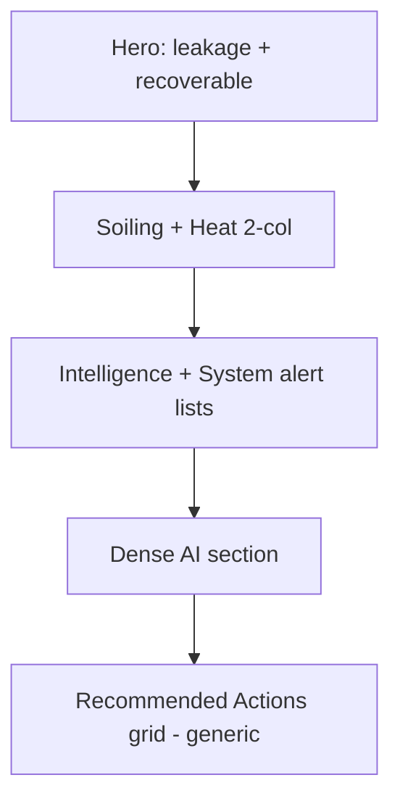
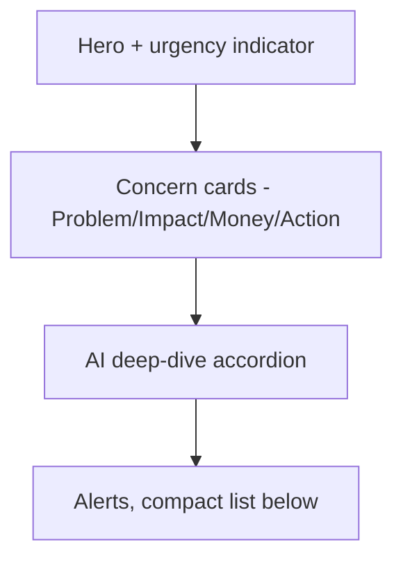

# 03 — Maintenance

Score baseline: **7.5/10**. Gap: reads like a technical report. Should read like a guided maintenance workflow.

References: [00-design-tokens.md](./00-design-tokens.md), [01-state-contracts.md](./01-state-contracts.md), [11-ai-insight-card.md](./11-ai-insight-card.md), [13-voice-and-copy.md](./13-voice-and-copy.md), [15-conversion-flow.md](./15-conversion-flow.md).

---

## 1. Current state

- Page: [apps/web/src/app/maintenance/page.tsx](../../apps/web/src/app/maintenance/page.tsx)
- AI section: [apps/web/src/app/maintenance/_components/maintenance-ai-insights-section.tsx](../../apps/web/src/app/maintenance/_components/maintenance-ai-insights-section.tsx)
- States: `apps/web/src/app/maintenance/_components/maintenance-state.tsx`
- Layout: single full-width column with hero → soiling/heat 2-col → alerts lists → AI section → Recommended Actions grid.

---

## 2. Problems

- Feels report-like; user cannot quickly see urgency.
- Generic CTA ("Schedule inspection") versus the specificity of the rest of the system.
- AI section is visually heavy and hard to scan.

---

## 3. Redesign intent

Apply a single repeating pattern to every maintenance concern: **Problem → Impact → Money → Action**. Add an urgency indicator in the hero. Replace the generic Recommended Actions grid with specific, monetized CTAs.

---

## 4. Layout — before vs after

### Before



### After



---

## 5. Component changes

### Modify

- [apps/web/src/app/maintenance/page.tsx](../../apps/web/src/app/maintenance/page.tsx) — hero gets an `urgency` pill derived from `SystemState` (`critical` / `warning` show it, others hide). Below the hero, render **Concern Cards** replacing the current soiling + heat split. Remove the standalone "Recommended Actions" grid at the bottom.
- [maintenance-ai-insights-section.tsx](../../apps/web/src/app/maintenance/_components/maintenance-ai-insights-section.tsx) — wrap into an accordion; default collapsed on `healthy`/`optimization`, expanded on `warning`/`critical`. Each row inside follows [11-ai-insight-card.md](./11-ai-insight-card.md).
- Alerts lists (intelligence + system) — collapse into a single compact list with severity chips, placed **after** the accordion, not above it.

### Add (documented only, not implemented here)

- `ConcernCard` — canonical Problem → Impact → Money → Action card used by every maintenance concern. See section 6.

---

## 6. ConcernCard specification

Fields (every concern must populate all six):

- `title` — e.g. "Dust buildup detected".
- `severity` — `"critical" | "warning" | "info"`.
- `impact` — short sentence, e.g. "−8% efficiency this month".
- `estimatedMonthlyLossNis` — number, rendered in `font-mono`.
- `confidence` — `"high" | "medium" | "low"` from the engine.
- `recommendedAction` — one sentence, active voice. E.g. "Book cleaning in the next 7 days".

Layout (`p-5`, `rounded-2xl`, state-tinted border from [00-design-tokens.md](./00-design-tokens.md)):

```
+-------------------------------------------------------+
| [Severity chip]  Title text-lg                        |
|                                                       |
| Impact line (text-sm)                                  |
| Estimated loss: N.IS 18.12 / month (font-mono)         |
|                                                       |
| Recommended: Book cleaning in the next 7 days          |
|                                                       |
| [Primary CTA] [Learn more - text link]   confidence px |
+-------------------------------------------------------+
```

Copy example (directly replaces the current "Schedule Inspection" card):

```
Dust risk is causing an estimated N.IS 18.12 monthly leakage.
Recommended action: schedule inspection or cleaning within 7 days.
```

---

## 7. State behavior

- `critical`: hero red-tinted, urgency = "Immediate action"; ConcernCards sorted by `estimatedMonthlyLossNis` descending; primary CTA solid.
- `warning`: hero amber-tinted, urgency = "Action recommended"; ConcernCards sorted by severity then loss.
- `optimization`: hero neutral-positive, urgency hidden; ConcernCards show only if present; otherwise render the healthy summary from [12-empty-states.md](./12-empty-states.md).
- `healthy`: hero neutral-positive, urgency hidden; no ConcernCards; compact "next scheduled check" line.
- `no-data`: zero-data experience (connect system + estimated simulation).

---

## 8. Action mapping (to marketplace / conversion)

Every ConcernCard CTA routes into the conversion flow defined in [15-conversion-flow.md](./15-conversion-flow.md) with `recommendationType` derived from the concern:

- Soiling → `soiling` → cleaning + robotic-cleaner categories.
- Heat / thermal → `automation_opportunity` (cooling window automation) or `cleaning` if dust-correlated.
- Fault alert → `provider-service` (inspection).

See [14-marketplace-catalog.md](./14-marketplace-catalog.md) for the mapping table.

---

## 9. Instrumentation

- `maintenance_concern_impression` — `{ concernId, severity, estimatedMonthlyLossNis }`.
- `maintenance_concern_cta_click` — `{ concernId, recommendationType, confidence }`.
- `maintenance_ai_accordion_toggle` — `{ opened }`.

---

## 10. Definition of Done

- Every maintenance concern renders as a `ConcernCard` with all six fields populated; no concern ships with missing Money or Action.
- Hero urgency pill only appears in `critical` / `warning` states.
- AI section is an accordion; default open only on `warning` / `critical`.
- The string "Schedule inspection" is removed from the page unless it appears as a concern-specific `recommendedAction`.
- All CTAs route through the conversion flow in [15-conversion-flow.md](./15-conversion-flow.md) with a valid `recommendationType`.
