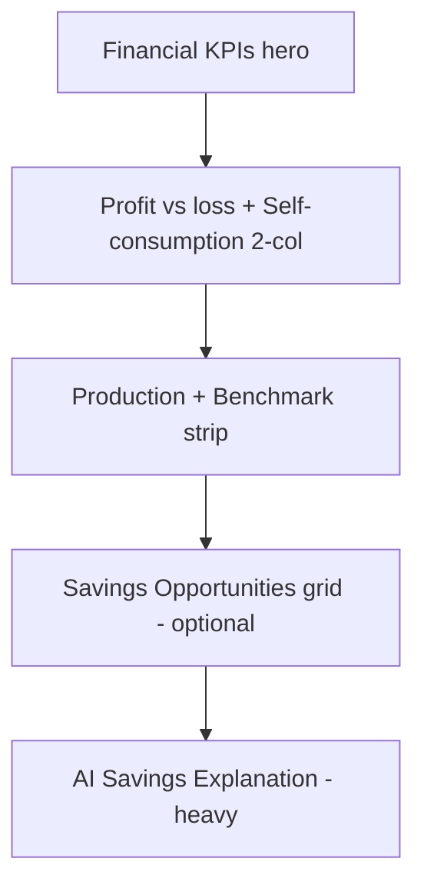
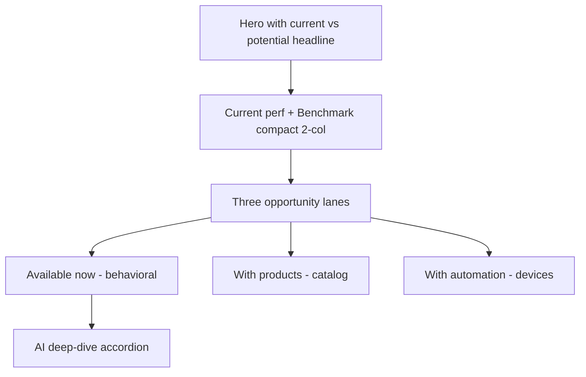

# 04 — Savings

Score baseline: **8/10**. Gap: analytical rather than persuasive; "with upgrades" empty state is weak.

References: [00-design-tokens.md](./00-design-tokens.md), [01-state-contracts.md](./01-state-contracts.md), [11-ai-insight-card.md](./11-ai-insight-card.md), [12-empty-states.md](./12-empty-states.md), [13-voice-and-copy.md](./13-voice-and-copy.md), [14-marketplace-catalog.md](./14-marketplace-catalog.md).

---

## 1. Current state

- Page: [apps/web/src/app/savings/page.tsx](../../apps/web/src/app/savings/page.tsx)
- AI section: [apps/web/src/app/savings/_components/savings-ai-insights-section.tsx](../../apps/web/src/app/savings/_components/savings-ai-insights-section.tsx)
- Layout: financial hero → profit vs loss + export vs self-consumption 2-col → production & benchmark strip → optional opportunities grid → AI section.

---

## 2. Problems

- Data-first, not story-first. No single headline tells the user "you could earn more".
- AI section is text-heavy, still looks like engine output.
- "With upgrades" region is weak when empty and weakens the whole page.

---

## 3. Redesign intent

Lead with a **current vs potential** headline. Split opportunities into three clean lanes: **Available now / With products / With automation**. Ensure every empty state is informative, not blank.

---

## 4. Layout — before vs after

### Before



### After



---

## 5. Hero copy

One additional strong line on top of the existing KPIs:

```
You are currently saving N.IS 706.50 / month.
You could increase this to N.IS 736.50 / month.
```

Derivation: `current` from the savings view-model, `potential` = `current + sum(high + medium priority opportunities' monthlyGain)`.

State behavior:

- `healthy` / `optimization`: show both lines.
- `warning` / `critical`: prepend an inline banner "Loss detected — see maintenance" linking to [03-maintenance.md](./03-maintenance.md).
- `no-data`: zero-data experience from [12-empty-states.md](./12-empty-states.md).

---

## 6. Opportunity lanes

Each lane renders Insight Cards per [11-ai-insight-card.md](./11-ai-insight-card.md). Lane fields:

- Lane title (e.g. "Available now"), lane subtitle (1 sentence), total `monthlyGain` chip.
- Up to 3 Insight Cards per lane, sorted by `monthlyGain` descending.
- "See all" link opens [07-opportunities.md](./07-opportunities.md).

### Lane contract

- **Available now** — behavioral actions requiring no purchase (shift usage, enable export window). `recommendationType` ∈ `automation_opportunity` (behavioral), occasionally `soiling` if a maintenance action is the biggest available gain.
- **With products** — hardware purchases (battery, EV charger, smart switch, boiler controller). `recommendationType` ∈ `battery_opportunity`, `ev_opportunity`, `low_self_consumption`.
- **With automation** — devices with automation benefit. `recommendationType = automation_opportunity` with a device target.

Empty-lane copy (replaces "No active items"):

```
No high-confidence upgrade recommendation is currently available.
Your best immediate gains are behavioral and automation-based.
```

Empty-lane CTA: text link "See all opportunities" routing to [07-opportunities.md](./07-opportunities.md).

---

## 7. Component changes

### Modify

- [apps/web/src/app/savings/page.tsx](../../apps/web/src/app/savings/page.tsx) — add the current-vs-potential headline into the hero; replace the single "Savings Opportunities" grid with three typed lanes. Keep the production + benchmark strip, compact it to fit.
- [savings-ai-insights-section.tsx](../../apps/web/src/app/savings/_components/savings-ai-insights-section.tsx) — convert to an accordion; per-row items render as Insight Cards.

### Remove

- The generic "No active items" empty copy. Replaced by the copy block above.

---

## 8. Instrumentation

- `savings_lane_impression` — `{ lane, itemCount, totalMonthlyGainNis }`.
- `savings_opportunity_cta_click` — `{ itemId, lane, recommendationType, confidence }`.
- `savings_accordion_toggle` — `{ opened }`.

---

## 9. Definition of Done

- Hero renders the two-line current-vs-potential copy using view-model math.
- Three lanes render with correct `recommendationType` filtering.
- Empty lanes never render the string "No active items"; they use the copy in section 6.
- AI section is an accordion.
- All CTAs route through [15-conversion-flow.md](./15-conversion-flow.md).
