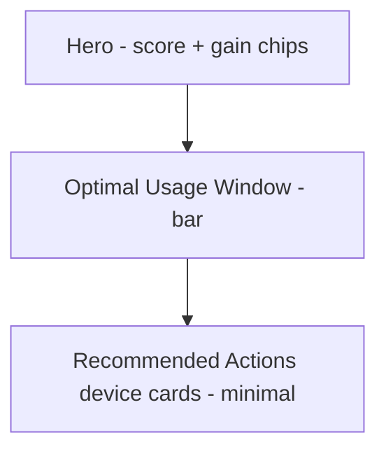
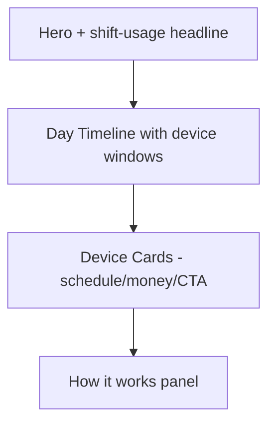

# 06 — Automation

Score baseline: **8/10**. Gap: feels informational; should feel like control. Usage window could be more visual.

References: [00-design-tokens.md](./00-design-tokens.md), [01-state-contracts.md](./01-state-contracts.md), [11-ai-insight-card.md](./11-ai-insight-card.md), [13-voice-and-copy.md](./13-voice-and-copy.md), [14-marketplace-catalog.md](./14-marketplace-catalog.md), [15-conversion-flow.md](./15-conversion-flow.md).

---

## 1. Current state

- Page: [apps/web/src/app/automation/page.tsx](../../apps/web/src/app/automation/page.tsx)
- Uses inline sections (no shared components from `components/dashboard/`).
- Layout: hero (self-consumption score + potential gain) → Optimal Usage Window strip → Recommended Actions device cards → footer.

---

## 2. Problems

- Device cards too minimal — no schedule, no money detail, no CTA richness.
- Usage window is a bar; could be a real day timeline.
- Page reads informational; it should feel interactive.

---

## 3. Redesign intent

Elevate Automation to a **control surface**: real day timeline showing recommended device windows, device cards that carry schedule + monthly + yearly gain + one-click configure CTA, and a short "How it works" panel that removes adoption friction.

---

## 4. Layout — before vs after

### Before



### After



---

## 5. Hero

Keep the existing self-consumption score and monthly potential gain chips. Add one directive line:

```
Shift more of your home usage into solar production hours.
```

State behavior:

- `healthy` / `optimization`: show hero as described.
- `warning` / `critical`: prepend a small banner linking back to the problem surface (maintenance or alerts); the automation page does not absorb critical-maintenance weight.
- `no-data`: zero-data experience.

---

## 6. Day Timeline

Replace the current linear bar with a horizontal **24h day timeline**. Tokens per [00-design-tokens.md](./00-design-tokens.md).

Requirements:

- Horizontal strip, 24 hour ticks at the bottom.
- Three visual bands labelled: **Morning** (06–10), **Peak solar** (10–16), **Evening** (16–22).
- Overlay shaded segments per recommended device window (e.g. Boiler 12:00–14:00).
- Legend row below listing each device window with a colored dot.
- On hover / tap, a tooltip shows the device name, recommended window, and monthly gain.

ASCII sketch:

```
 Morning         |    Peak solar     |   Evening
 06 07 08 09 10 | 11 12 13 14 15 16 | 17 18 19 20 21 22
               [====== Boiler ======]
                        [=== Dishwasher ===]
                              [=== EV charge ===]
```

Implementation note: this is still inline in [apps/web/src/app/automation/page.tsx](../../apps/web/src/app/automation/page.tsx) today. Consider extracting to `apps/web/src/components/dashboard/AutomationDayTimeline.tsx` during Sprint 3 (documented only, do not create now).

---

## 7. Device Card schema

Each device card must carry:

- `device` — e.g. "Boiler", "Dishwasher", "EV Charger".
- `icon` — category icon.
- `why` — one sentence describing the benefit (e.g. "Run heating on surplus solar").
- `schedule` — recommended window, e.g. "12:00–14:00".
- `monthlyGainNis` and `yearlyGainNis` — numeric.
- `confidence` — maps to CTA intensity per [01-state-contracts.md](./01-state-contracts.md).
- `cta` — "Configure Automation" (default) or "Explore devices" when no device is detected.

Visual example:

```
+-------------------------------------------------+
| [icon] Boiler                                   |
|                                                 |
| Recommended run time: 12:00–14:00               |
| Estimated gain: N.IS 55.62 / month              |
| Yearly: N.IS 667 / year                         |
|                                                 |
| [Configure Automation]   confidence: high       |
+-------------------------------------------------+
```

Tokens: `p-5`, `rounded-2xl`, internal `gap-3`, CTA row `mt-4`.

---

## 8. "How it works" panel

Small muted panel under the device grid. Three bullets, no illustrations required:

- No battery required.
- Automation improves your self-consumption ratio.
- Reduces grid purchase costs during peak tariff hours.

CTA: text link "See supported devices" routing to [07-opportunities.md](./07-opportunities.md) → automation section.

---

## 9. Component changes

### Modify

- [apps/web/src/app/automation/page.tsx](../../apps/web/src/app/automation/page.tsx):
  - Replace the current Optimal Usage Window bar with the Day Timeline spec in section 6.
  - Replace the current Recommended Actions grid with device cards following the schema in section 7.
  - Append the "How it works" panel after the device grid.
  - Add the hero directive line in section 5.

### Add (documented only)

- `AutomationDayTimeline.tsx` component (future extraction for Sprint 3).
- `AutomationDeviceCard.tsx` component (future extraction).

---

## 10. Mapping to marketplace

Device CTAs route through [15-conversion-flow.md](./15-conversion-flow.md) with:

- `recommendationType = "automation_opportunity"`.
- `deviceTarget ∈ {"boiler", "dishwasher", "ev-charger", "smart-switch"}`.

Downstream catalog routes these to `smart-switch` and `boiler-controller` categories in [14-marketplace-catalog.md](./14-marketplace-catalog.md) when the user lacks the hardware.

---

## 11. Instrumentation

- `automation_timeline_hover` — `{ deviceTarget, windowStart, windowEnd }`.
- `automation_device_cta_click` — `{ deviceTarget, monthlyGainNis, confidence }`.
- `automation_howitworks_link_click` — no props.

---

## 12. Definition of Done

- Day Timeline renders 24 ticks, three bands, and per-device overlays with legend.
- Every device card populates `device`, `schedule`, `monthlyGainNis`, `yearlyGainNis`, `confidence`, `cta`.
- "How it works" panel is present under the device grid.
- Hero includes the directive line on `healthy` / `optimization` states.
- Every CTA routes through the conversion flow with `recommendationType = "automation_opportunity"`.
