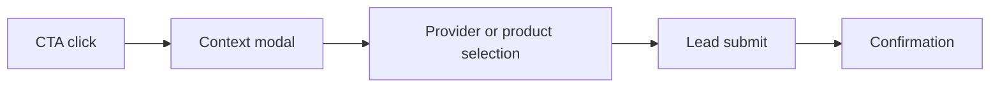

# 15 — Conversion Flow

Every CTA in the product — dashboard action lanes, maintenance concerns, savings lanes, automation devices, opportunities cards — funnels into the same conversion flow. This doc defines that flow end to end.

References: [01-state-contracts.md](./01-state-contracts.md), [07-opportunities.md](./07-opportunities.md), [11-ai-insight-card.md](./11-ai-insight-card.md), [14-marketplace-catalog.md](./14-marketplace-catalog.md), [17-monetization.md](./17-monetization.md).

---

## 1. The flow

Five steps, always in this order:



The modal keeps the user on the current page. Confirmation returns to the originating surface with a success chip.

---

## 2. Step 1 — CTA click

Every CTA component (Insight Card, Opportunity Card, Concern Card, Device Card, Hero CTA) calls a shared handler. The handler receives a context payload:

```ts
type ConversionContext = {
  sourceSurface: "dashboard_hero" | "dashboard_now" | "dashboard_recommended" | "dashboard_explore"
                 | "maintenance_concern" | "savings_lane" | "automation_device"
                 | "opportunities_section";
  recommendationType: RecommendationType;   // from doc 14
  catalogItemId?: string;                   // when coming from a specific card
  deviceTarget?: "boiler" | "dishwasher" | "ev-charger" | "smart-switch";
  monthlyGainNis?: number;
  confidence: "high" | "medium" | "low";
  priority: "high" | "medium" | "low";
};
```

The handler emits `cta_click` (see [17-monetization.md](./17-monetization.md) events) and opens the modal.

---

## 3. Step 2 — Context modal

A single modal component, opened via [ui/dialog.tsx](../../apps/web/src/components/ui/dialog.tsx) conventions.

Sections inside:

- **Header** — Issue line + money line, matching the Insight Card that triggered the modal.
- **What happens next** — 3 bullet points tailored to the `ctaKind`:
  - `quote` — "We'll share your system details with up to 3 verified providers. You'll receive quotes within 48 hours."
  - `book` — "We'll schedule a visit with a verified local provider. You pick a preferred window."
  - `configure` — "We'll guide you through device setup. No purchase needed if you already own the hardware."
  - `external` — "We'll redirect you to the manufacturer's site. You can return to complete setup."
- **Continue** button → Step 3.
- **Cancel** → closes modal, emits `modal_dismiss`.

No personal data is captured in this step.

---

## 4. Step 3 — Provider or product selection

Surface depends on `ctaKind`:

- `book` / `quote` → list of providers filtered by `serviceArea` that `applyTo` the `recommendationType` (see [14-marketplace-catalog.md](./14-marketplace-catalog.md) section 5).
- `configure` → list of supported devices for the `deviceTarget`.
- `external` → skip this step (go straight to step 4 with `providerId = "external"`).

List item rendering:

- Provider logo / product thumbnail.
- Name + verified chip (if `verified`).
- Service area or region line.
- Price or gain line.
- "Select" button per row.

### Fallback: no matches

When the selection list is empty:

```
No verified providers match your area yet.
We can notify you as soon as a provider becomes available, or continue by listing your details.
```

Two buttons: "Notify me" (captures email into a waitlist) and "Continue anyway" (proceeds with `providerId = "any"`).

---

## 5. Step 4 — Lead submit

Form with the minimum fields to make the lead actionable:

- Name (required).
- Phone (required). Validated via a simple phone-format check.
- Email (optional if phone present; otherwise required).
- Preferred time window (for `book`); free text note (for `quote` / `configure`).
- Consent checkbox: "I agree to share my system summary with the selected provider." (required).

Submit payload:

```ts
type LeadPayload = {
  userId: string;
  siteId: string;
  recommendationId?: string;       // the engine recommendation that triggered this
  catalogItemId?: string;          // the card the user clicked (if any)
  providerId?: string;             // the selected provider, "any", or "external"
  recommendationType: RecommendationType;
  ctaKind: "quote" | "configure" | "book" | "external";
  sourceSurface: ConversionContext["sourceSurface"];
  monthlyGainNis?: number;
  contact: {
    name: string;
    phone?: string;
    email?: string;
    preferredWindow?: string;
    note?: string;
  };
  consent: { acceptedAt: string };
  createdAt: string;
};
```

Submission is optimistic:

- Show an inline spinner on the submit button.
- On success: go to step 5.
- On failure: inline error "We couldn't send that. Retry." with a retry button. Server validation errors surface inline on the offending field.

---

## 6. Step 5 — Confirmation

Replace the modal content with a confirmation screen:

- Title: "Request sent" (or "Booking request sent" for `book`).
- Timeline bullet: "A provider will contact you within 48 hours." (for `quote` / `book`).
- Secondary CTA: "See what else you can improve" → Opportunities page.
- Primary CTA: "Done" closes the modal.
- A success chip also renders on the originating surface for 4 seconds after close.

Copy must follow [13-voice-and-copy.md](./13-voice-and-copy.md).

---

## 7. Error handling matrix

- **Network failure at submit** — retry button. After 3 failed retries, offer an email fallback: "We'll save this and email it when we reconnect."
- **Validation failure** — inline per-field. Do not reset the form.
- **Provider list load failure** — show the fallback block in section 4 with "Retry" as the primary action.

---

## 8. Analytics events

Events emitted from the flow (see [17-monetization.md](./17-monetization.md) for the full schema):

- `cta_click` — at step 1.
- `modal_open` — at step 2.
- `modal_dismiss` — on cancel.
- `provider_selected` — at step 3.
- `lead_submit_attempt` — at step 4 button click.
- `lead_submitted` — on success.
- `lead_submit_failed` — on error.
- `conversion_complete` — at step 5.

---

## 9. Component changes (documented only)

Future Sprint 2 implementation (not in this phase):

- `apps/web/src/components/conversion/ConversionModal.tsx`
- `apps/web/src/components/conversion/ProviderPicker.tsx`
- `apps/web/src/components/conversion/LeadForm.tsx`
- A shared `useConversionFlow()` hook that every CTA calls.

All current CTAs across [EnergyDecisionsSection.tsx](../../apps/web/src/components/dashboard/EnergyDecisionsSection.tsx), [MarketplaceActionCard.tsx](../../apps/web/src/components/dashboard/MarketplaceActionCard.tsx), [OpportunityActionCard.tsx](../../apps/web/src/components/dashboard/OpportunityActionCard.tsx), [opportunity-card.tsx](../../apps/web/src/app/opportunities/_components/opportunity-card.tsx), maintenance concerns, savings lanes, and automation device cards migrate to call `useConversionFlow()` instead of bespoke handlers.

---

## 10. Definition of Done

- Every CTA in the product opens the shared modal; no bespoke lead forms remain.
- `LeadPayload` shape is the only thing sent to `/leads` (or equivalent endpoint).
- Provider selection respects `serviceArea` filtering.
- No-provider fallback presents "Notify me" and "Continue anyway".
- All eight analytics events in section 8 fire with their specified props.
- Confirmation screen is reachable from a cold modal open in under 3 clicks for `quote` / `book` flows.
