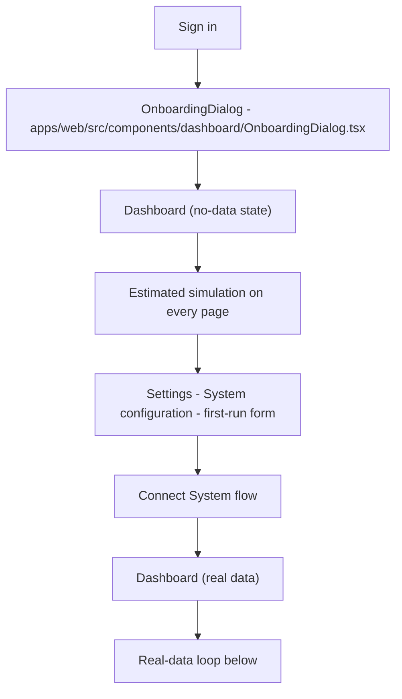
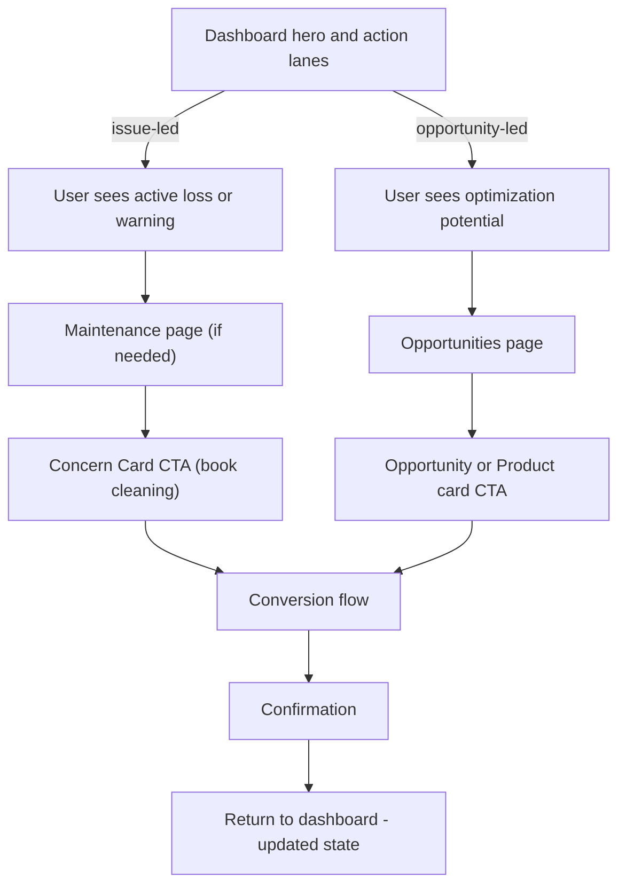
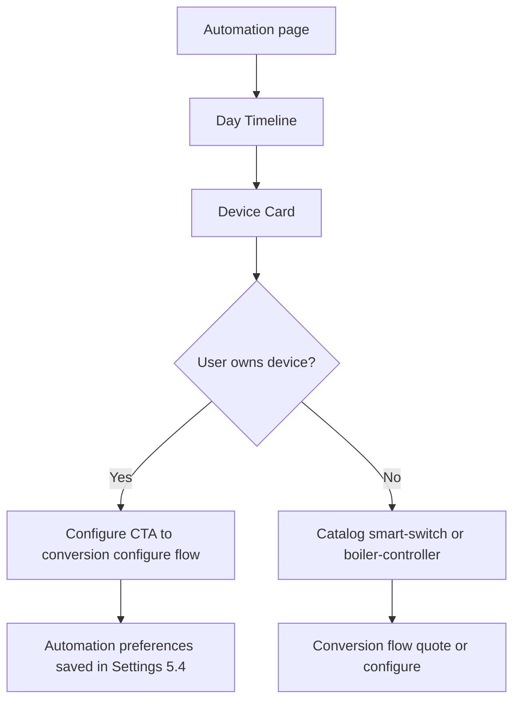
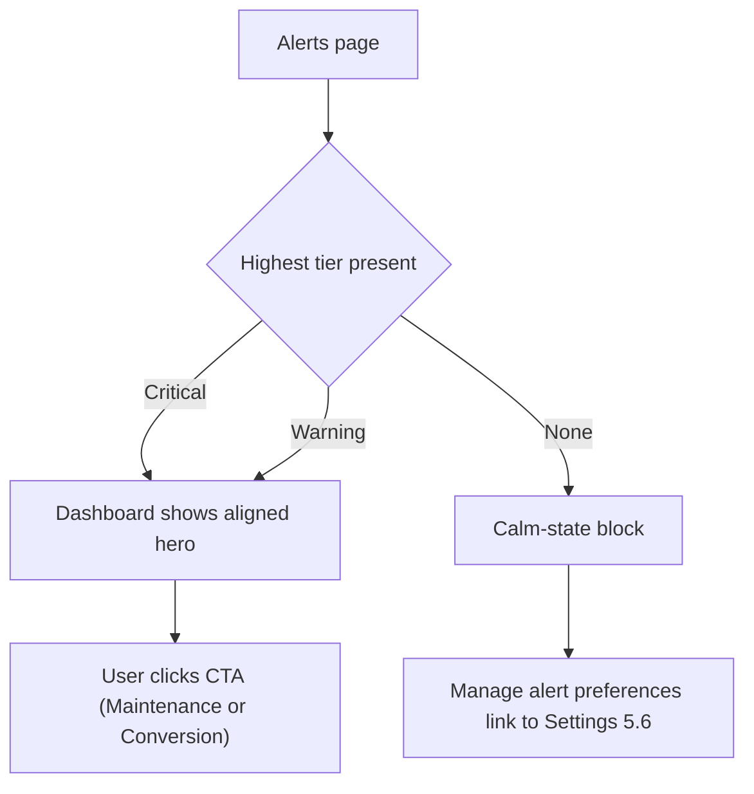

# 16 — User Journey

Pages don't live alone. This doc describes how a user moves through the product, page by page, and which spec documents own each hop.

References: [02-dashboard.md](./02-dashboard.md), [07-opportunities.md](./07-opportunities.md), [15-conversion-flow.md](./15-conversion-flow.md), [08-settings.md](./08-settings.md), [12-empty-states.md](./12-empty-states.md).

---

## 1. First-time user journey (zero-data)

Ownership:

- Onboarding surface → [OnboardingDialog.tsx](../../apps/web/src/components/dashboard/OnboardingDialog.tsx) (existing).
- Zero-data experience across all pages → [12-empty-states.md](./12-empty-states.md) section 3.
- Settings first-run → [08-settings.md](./08-settings.md) section 5.1 + section 8.
- Connect System entry points → [HardwareConnectCta.tsx](../../apps/web/src/components/dashboard/HardwareConnectCta.tsx) and the sidebar utility zone in [09-sidebar-shell.md](./09-sidebar-shell.md).

---

## 2. Real-data loop (the core product flow)

Ownership:

- Dashboard hero + lanes → [02-dashboard.md](./02-dashboard.md).
- Issue-led path → [03-maintenance.md](./03-maintenance.md).
- Opportunity-led path → [04-savings.md](./04-savings.md) and [07-opportunities.md](./07-opportunities.md).
- Conversion funnel → [15-conversion-flow.md](./15-conversion-flow.md).

---

## 3. Automation journey

Ownership:

- Automation page → [06-automation.md](./06-automation.md).
- Device → product routing → [14-marketplace-catalog.md](./14-marketplace-catalog.md) mapping.
- Saved preferences → [08-settings.md](./08-settings.md) section 5.4.

---

## 4. Alerts journey

Ownership:

- Alerts tiers → [05-alerts.md](./05-alerts.md).
- Cross-page consistency → [01-state-contracts.md](./01-state-contracts.md).
- Preferences → [08-settings.md](./08-settings.md) section 5.6.

---

## 5. Return-user moments

After a conversion:

- Dashboard state may change from `warning` to `healthy` once a provider visit completes (data will reflect it on next ingestion).
- A small banner may appear: "Your recent cleaning recovered N.IS X/month." (post-event reconciliation; implementation deferred).

After a settings change:

- Recommendations recompute via `router.refresh()` (see [08-settings.md](./08-settings.md) section 7).
- Dashboard opportunity ordering updates accordingly.

---

## 6. Consistency guarantees

- The Insight Card shape never changes between pages (per [11-ai-insight-card.md](./11-ai-insight-card.md)).
- `SystemState` transitions are the same across pages (per [01-state-contracts.md](./01-state-contracts.md)).
- Every CTA — anywhere — routes through the same conversion flow (per [15-conversion-flow.md](./15-conversion-flow.md)).
- Copy tone stays unified (per [13-voice-and-copy.md](./13-voice-and-copy.md)).

These four guarantees are the reason pages can be shipped independently without visibly breaking the journey.

---

## 7. Definition of Done

- From the dashboard, a user can reach the conversion confirmation screen for a `soiling` issue in under four clicks.
- From the dashboard, a user can reach the conversion confirmation screen for a `battery_opportunity` in under five clicks.
- Zero-data users can complete the first-run configuration form in under two minutes.
- After a saved setting change, at least one surface on the dashboard visibly updates (card order, potential gain number, or automation device window).
- Navigation between pages preserves the site selection (`sip.activeSiteId` cookie).
