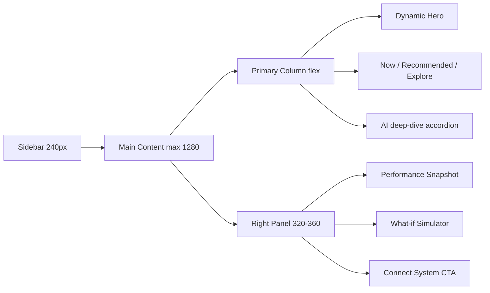

# Redesign Spec — Solar Intelligence Platform

This folder is an **execution-ready UX specification** for the web app at [apps/web](../../apps/web). It converts the page-by-page product critique into a structured set of documents engineering can implement against, sprint by sprint.

No code has been changed by this spec. Every instruction cites a real file under [apps/web/src](../../apps/web/src).

---

## Document index

Foundation contracts (read first):

- [00-design-tokens.md](./00-design-tokens.md) — spacing scale, container widths, padding system, radius, elevation, color tokens.
- [01-state-contracts.md](./01-state-contracts.md) — `SystemState`, `ActionPriority`, AI confidence → UI behavior matrix.

Per-page redesign:

- [02-dashboard.md](./02-dashboard.md) — command center, dynamic hero, Now / Recommended / Explore grouping, **ASCII pixel wireframe**.
- [03-maintenance.md](./03-maintenance.md) — Problem → Impact → Money → Action pattern, urgency indicator.
- [04-savings.md](./04-savings.md) — current-vs-potential headline, Available now / With products / With automation split.
- [05-alerts.md](./05-alerts.md) — Critical / Warning / Informational tiering, filter chips, calm-state block.
- [06-automation.md](./06-automation.md) — day-timeline visualization, device card schema, "How it works" panel.
- [07-opportunities.md](./07-opportunities.md) — grouped marketplace sections, card field contract.
- [08-settings.md](./08-settings.md) — six-section control-center IA with downstream effects.
- [09-sidebar-shell.md](./09-sidebar-shell.md) — premium lockup, nav states, bottom utility zone, mobile drawer.

Cross-cutting systems:

- [10-responsive.md](./10-responsive.md) — breakpoints, stacking rules, right-panel collapse sequence.
- [11-ai-insight-card.md](./11-ai-insight-card.md) — canonical Insight Card component spec.
- [12-empty-states.md](./12-empty-states.md) — healthy / empty / loading / error patterns + zero-data new-user experience.
- [13-voice-and-copy.md](./13-voice-and-copy.md) — tone rules, banned phrasings, RTL / currency formatting.

Data and commerce:

- [14-marketplace-catalog.md](./14-marketplace-catalog.md) — typed mock catalog, seed items, `RecommendationType` → catalog mapping.
- [15-conversion-flow.md](./15-conversion-flow.md) — CTA → Modal → Provider → Lead → Confirmation, payload, fallbacks.

Product layers:

- [16-user-journey.md](./16-user-journey.md) — cross-page flow with mermaid diagram.
- [17-monetization.md](./17-monetization.md) — revenue surfaces, UI → revenue mapping, instrumentation events.

---

## Current page scoring (baseline from critique)

- Dashboard — 8/10 — needs stronger hierarchy.
- Maintenance — 7.5/10 — too report-like.
- Savings — 8/10 — needs better conversion framing.
- Alerts — 6.5/10 — empty-state weakness.
- Automation — 8/10 — needs more control feeling.
- Opportunities — 6/10 — not real enough yet.
- Sidebar / Shell — 8/10 — needs polish.
- Responsive UX — 6.5/10 — desktop-first only.

---

## Sprint reading order

Implement sprints in the order below. Each sprint references a subset of documents; reading outside of that subset is optional.

**Sprint 1 — Dashboard hierarchy + AI compaction**

- [00-design-tokens.md](./00-design-tokens.md)
- [01-state-contracts.md](./01-state-contracts.md)
- [02-dashboard.md](./02-dashboard.md)
- [11-ai-insight-card.md](./11-ai-insight-card.md)
- [12-empty-states.md](./12-empty-states.md)
- [13-voice-and-copy.md](./13-voice-and-copy.md)

**Sprint 2 — Marketplace + conversion**

- [07-opportunities.md](./07-opportunities.md)
- [14-marketplace-catalog.md](./14-marketplace-catalog.md)
- [15-conversion-flow.md](./15-conversion-flow.md)
- [17-monetization.md](./17-monetization.md)

**Sprint 3 — Automation + maintenance + settings**

- [03-maintenance.md](./03-maintenance.md)
- [06-automation.md](./06-automation.md)
- [08-settings.md](./08-settings.md)

**Sprint 4 — Responsive + shell + journey polish**

- [09-sidebar-shell.md](./09-sidebar-shell.md)
- [10-responsive.md](./10-responsive.md)
- [16-user-journey.md](./16-user-journey.md)

---

## Target high-level layout

---

## Conventions

- **File citations** use relative markdown links, for example `[HeroInsightCard.tsx](../../apps/web/src/components/dashboard/HeroInsightCard.tsx)`. Every cited file must exist today.
- **Shared contracts come first.** Per-page docs reference `SystemState`, `ActionPriority`, and design tokens rather than redefining them.
- **Definition of Done** lives at the bottom of each per-page doc as a checklist. A page ships only when every item is ticked.
- **No emojis** anywhere in this spec.
- **No wide tables.** Use bullet lists.
- **Execution rule.** Docs describe *what* to build and *why*. Engineers pick the exact implementation detail as long as the DoD passes.

---

## How to update these docs

When a page ships:

1. Tick the Definition of Done checklist in that page's doc.
2. If the shipped implementation diverged, update the doc so it matches reality (docs must not lie).
3. If a contract (state, priority, tokens) changed, update the foundation doc first, then cascade.

---

## Out of scope

- Actual component refactors.
- Building the marketplace JSON files or TypeScript types.
- Landing page, onboarding illustration work, provider demo flows.
- Backend changes in [apps/api](../../apps/api) or [apps/engine](../../apps/engine). The spec only describes the contract shape the frontend expects from those services.
